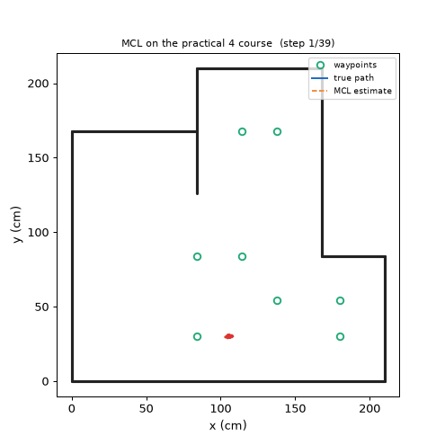
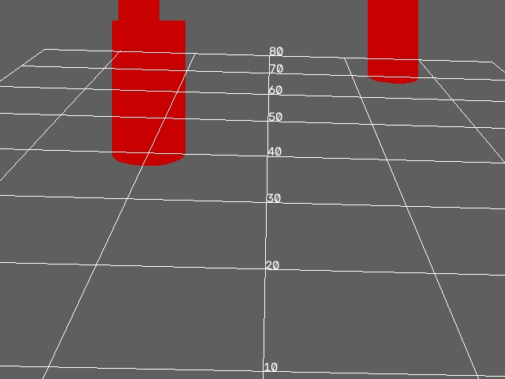
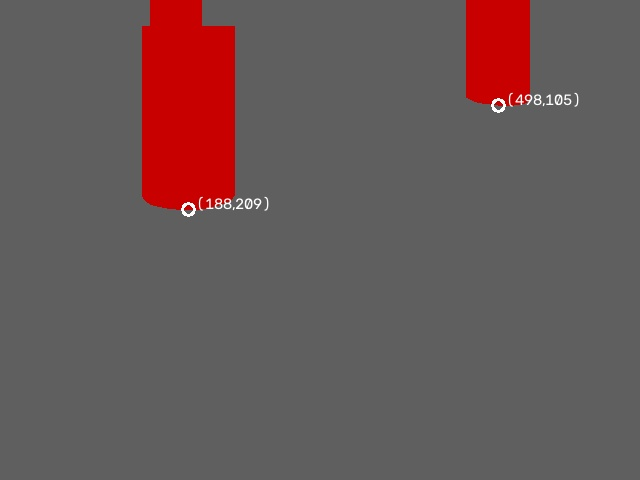
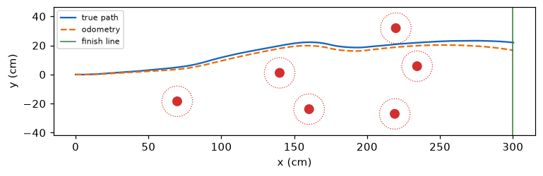
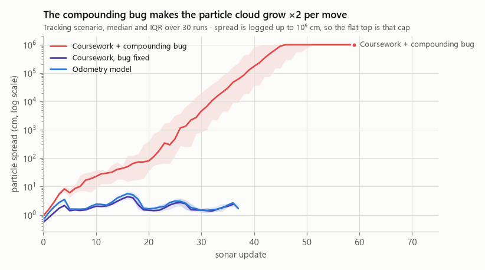
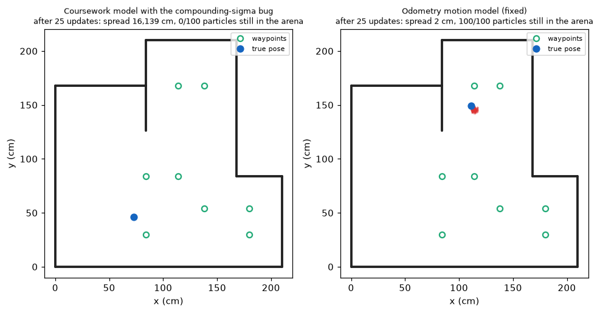
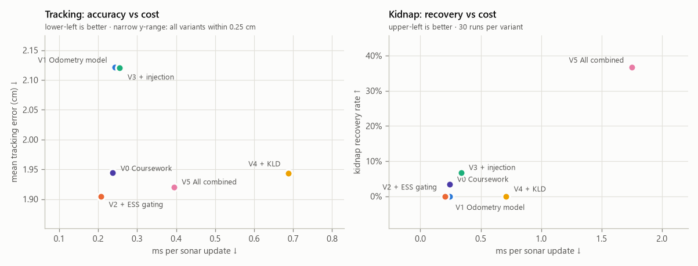
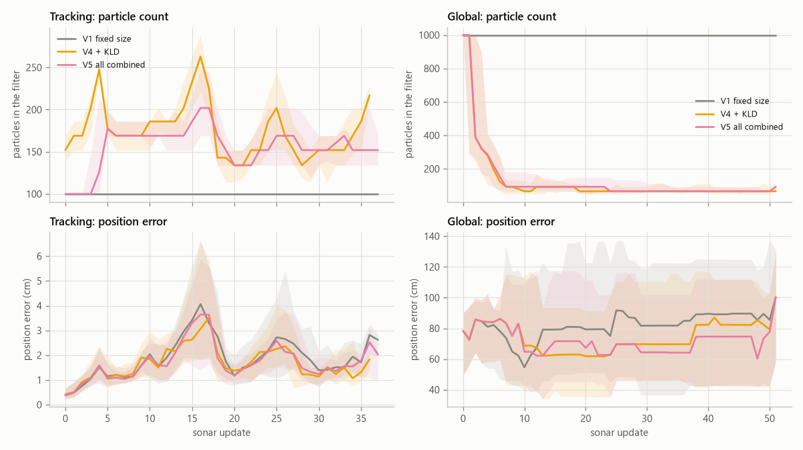
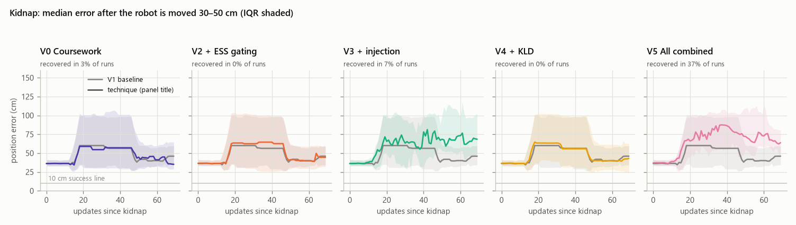
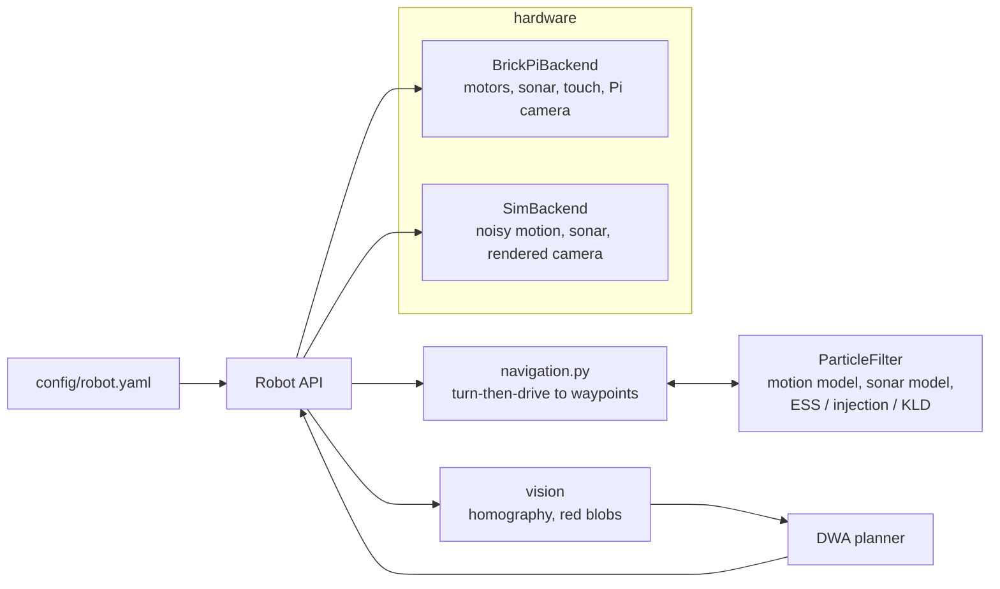

# lego-mcl-robot

Monte Carlo Localisation, camera-based obstacle avoidance and a particle-filter noise
study for a LEGO robot driven by a Raspberry Pi + BrickPi3. The same code runs on the
real robot or in the included simulator.



*The particle filter (red arrows) tracks the robot (blue path) around an 8-waypoint
course, using one forward-facing sonar and dead reckoning.*

## Highlights

- **Monte Carlo Localisation** with ray-cast sonar likelihoods, vectorised in NumPy.
- **Noise study.** Four published techniques, reimplemented and benchmarked in 3
  scenarios × 30 seeds:
  - the odometry motion model,
  - ESS-gated low-variance resampling,
  - augmented-MCL particle injection,
  - KLD-sampling.

  The study started from a bug in the original coursework that made the particle cloud
  grow without bound. → [docs/noise_study.md](docs/noise_study.md)
- **Vision.** A ground-plane homography from 4 floor/pixel correspondences, and HSV
  colour segmentation that projects each red can's bottom edge to floor coordinates.
- **Planning.** A Dynamic Window Approach planner that drives 3 m through randomly
  placed cans using only the current camera frame.
- **Simulator.** Noisy odometry, a sonar with lost echoes and outliers, bumpers, and
  rendered camera frames. The full vision → planning loop is tested end to end without
  the robot.
- **One config file** ([config/robot.yaml](config/robot.yaml)) for every parameter,
  **47 tests**, and lint-clean code.

| Vision: calibrated floor grid | Vision: detected cans | DWA through random cans |
|---|---|---|
|  |  |  |

## Noise study: results and analysis

The original coursework had a particle cloud that kept growing until localisation broke.
I traced that to a bug, fixed it, and then reimplemented four published techniques for
keeping particle-filter noise under control, in the forms ROS AMCL and PythonRobotics
use them.

Each variant was run 30 times in each of 3 simulated scenarios:

- **Tracking:** known start, then drive the 8-waypoint course.
- **Kidnap:** the robot is picked up mid-course and moved 30–50 cm.
- **Global:** the start position is unknown.

| Key | Variant | Paper |
|---|---|---|
| V0 | Coursework motion model (bug fixed) | n/a |
| V1 | Odometry motion model, **the baseline** | Thrun, Burgard & Fox 2005 |
| V2 | V1 + ESS-gated resampling | Kong, Liu & Wong 1994; Kitagawa 1996 |
| V3 | V1 + augmented-MCL random injection | Thrun et al. 2001; Gutmann & Fox 2002 |
| V4 | V1 + KLD-sampling | Fox 2001, 2003 |
| V5 | All of the above | n/a |

In the comparison charts, V1 is drawn in gray and the technique being compared is in
colour. Each variant keeps the same colour in every chart.

### 1. The growing noise was a bug



The coursework waypoint script multiplied the stored noise parameters by `distance / 10`
before every move, and the motion model then scaled them by `distance / 10` again. With
20 cm steps, the noise doubled on every move.

- The red curve rises in a straight line on a log scale, which is the signature of
  exponential growth. Its spread reaches 10⁶ cm (10 km) within about 45 updates
  (the flat top is my logging cap).
- The buggy filter diverged in **30 of 30 runs**.
- Both fixed models stay at 1–5 cm for the whole course, and they're almost
  indistinguishable.

**Conclusion:** motion noise must depend only on the current motion. The odometry model
from *Probabilistic Robotics* formalises that, and a unit test now guards against the
regression.



Same course, same random seed, after 25 sonar updates. On the left, no particle of the
buggy filter is left inside the arena. On the right, the fixed filter holds a 2 cm cloud
next to the true pose.

### 2. Scorecard: every variant on every metric


Each column is shaded relative to the other variants (darker = better), and the cells
show the actual measurements.

- **V2 (ESS gating)** is dark across the whole tracking block: lowest error (1.90 cm),
  most distinct particles (84%), fastest updates (0.21 ms). Every other column is
  roughly unchanged from the baseline. It's the only change that improves things for
  free.
- **V5 (all combined)** owns the kidnap-recovery column (37%), but it's the worst for
  wall contacts (87 per run) and among the slowest.
- **V4 (KLD)** is darkest on "global particles" (154 instead of 1,000) but lightest on
  tracking diversity (62%) and tracking cost.
- **V3 (injection alone)** improves nothing except a 7% kidnap recovery, and adds about
  70 wall contacts per run.
- The **global-converged** column is pale everywhere (3–7%): no filter technique fixes
  that scenario.

### 3. What each technique buys and what it costs



**Tracking (left).** Every variant is within 0.25 cm of the others. That's below what
the real sonar (σ = 1.5 cm) could resolve, so accuracy is effectively a tie, and cost is
the real axis.

- V2 sits in the best corner: cheapest and most accurate.
- V4 costs about 3× more for no gain.

**Kidnap (right).** Only V5 recovers meaningfully, and it sits far to the right at about
7× the baseline cost. Every other variant is clustered near 0% recovery.

### 4. Resampling only when needed (V1 vs V2)


- **Right:** ESS gating resamples on 30% of sonar updates, instead of 83% for V1. The
  remaining ~17% are out-of-range readings that both skip.
- **Left:** because V2 lets weights build up across several updates, they become more
  uneven before it acts (N_eff/N lower by about 0.1). That's expected and by design.
- **Middle:** the pay-off. V2 keeps more distinct particles almost everywhere along the
  course (84% vs 76% on average). Every unnecessary resample replaces distinct
  particles with duplicates (particle depletion), and gating avoids most of them.

**Conclusion:** resampling every update, as the coursework did, throws away diversity
for no benefit.

### 5. KLD-sampling: fewer particles, not more correct



**Global (right column)**
- KLD cuts the filter from 1,000 to about 70 particles within 10 updates, a 14×
  reduction in work.
- Its position error is no better than the fixed 1,000-particle filter's.
- KLD measures how *concentrated* the cloud is, not whether it's *right*. It shrinks
  just as confidently onto a wrong hypothesis.

**Tracking (left column)**
- KLD uses *more* particles than the fixed 100 (150–260), because a cloud a few cm wide
  spans several of its 5 cm × 15° histogram cells.
- The error curves of all three variants lie on top of each other.

**Conclusion:** KLD is a cost-control tool, and its cell size matters as much as its
error bound ε.

### 6. Recovering from a kidnap



Each panel compares one technique (colour) against V1 (gray), aligned on the moment the
robot is moved. Error starts at the 30–50 cm displacement and rises as the robot drives
on its wrong belief.

- **V0, V2 and V4 track the gray baseline almost exactly.** Motion models, resampling
  schedules and particle counts can't fix a wrong belief on their own.
- **V3** ends *above* the baseline. Random particles pull the estimate around, but with
  only 100 particles none land close enough to the truth to win.
- **V5** is the only panel whose interquartile band reaches below the 10 cm success
  line. It recovers in **37% of runs**, against 0–7% for everything else.

### 7. Why injection only works together with KLD


**Left:** after the kidnap, V3 can inject only about 10–25 random particles per update,
because its filter is fixed at 100. V5 injects 50–180.

**Right:** that happens because KLD reacts to injection. The injected particles widen the
cloud, KLD grows the filter to its 1,000-particle cap within about 12 updates, and the
larger filter gives the random guesses a realistic chance of landing near the true pose.

**Conclusion:** the two techniques are complementary. Injection supplies the new
hypotheses, and KLD supplies the room to hold them. This interaction is the most
interesting result of the study.

### 8. Every run, not just averages


Each dot is one run's final error (log scale), and the black bar is the median.

- **Tracking:** all 180 runs end below the 10 cm line, mostly within 0.3–6 cm. The
  spread *within* each variant is far larger than the differences *between* variants.
- **Kidnap:** the cluster of V5 dots around 1 cm is its recovered runs, separated from
  its failed runs by more than an order of magnitude. Recovery is all-or-nothing, not
  gradual.
- **Global:** every variant has the same pattern, a few runs under 10 cm and the rest
  50–200 cm off. With a single forward-facing sonar beam the robot's position just isn't
  observable enough. That's a sensor limit; a camera or a scanning sonar is the fix,
  not a different filter.

### Summary

| Variant | Tracking success | Kidnap recovery | Distinct particles | ms / update |
|---|---|---|---|---|
| Coursework model with the bug | 0% | n/a | n/a | 0.25 |
| Coursework model, bug fixed | 100% | 3% | 0.78 | 0.24 |
| Odometry motion model | 100% | 0% | 0.76 | 0.24 |
| + ESS-gated resampling | 100% | 0% | **0.84** | **0.21** |
| + augmented MCL injection | 100% | 7% | 0.76 | 0.26 |
| + KLD-sampling | 100% | 0% | 0.62 | 0.69 |
| All combined | 100% | **37%** | 0.82 | 0.39 |

**Recommendation for this robot:**
- **V2 (odometry model + ESS gating)** for everyday navigation. It's the most accurate
  and the cheapest.
- **V5 (all combined)** when the robot may be bumped or lose track. It's the only
  variant that recovers, at about 7× the compute.

**Caveats:**
- These are simulation results; the simulator's noise is set from the practical 1
  calibration.
- The thresholds were tuned on small grids.

The full method, the adaptations needed to make augmented MCL work with one sonar beam,
and the references are in [docs/noise_study.md](docs/noise_study.md).

## Quick start (no robot needed)

```bash
git clone <this repo> && cd lego-mcl-robot
python -m venv .venv && source .venv/bin/activate   # Windows: .venv\Scripts\activate
pip install -e ".[dev]"

python scripts/mcl_navigate.py --gif mcl.gif     # localise and drive the course -> outputs/
python scripts/dwa_challenge.py --seed 3         # camera + DWA obstacle course -> outputs/
python experiments/noise_study/run_benchmark.py  # full noise study (~40 s)
python experiments/noise_study/make_figures.py
pytest
```

## Scripts

Every script takes `--backend sim` (default) or `--backend brickpi`.

| Script | Practical | What it does |
|---|---|---|
| `calibrate_motors.py` | 1 | Lets the wheels spin freely and prints encoder counts, to measure degrees per cm (hardware only) |
| `drive_square.py` | 1 | Drives a 40 cm square; in sim, repeats it and prints the end-point error covariance |
| `bumper_avoid.py` | 2 | Bumper-driven obstacle avoidance |
| `wall_follow.py` | 2 | Holds a set sonar distance with P-control on a moving average |
| `calibrate_sonar.py` | 2 | Sonar bias, spread and garbage rate at known distances → CSV |
| `mcl_navigate.py` | 3–4 | Waypoint navigation with MCL (`--variant`, `--interactive`, `--web`, `--gif`) |
| `camera_grid.py` | 5 | Overlays the homography's 10 cm floor grid to check the calibration |
| `red_blobs.py` | 5 | Detects red objects and prints their floor coordinates |
| `dwa_challenge.py` | 6 | Drives 3 m past red cans with camera + DWA (`--video` to record) |

On the robot, `mcl_navigate.py` prints `drawLine:` / `drawParticles:` lines for the course
web viewer.

## How it fits together



```
config/robot.yaml           every parameter, defined once
src/legobot/
  hardware/                 Backend protocol, BrickPi3 backend, simulator, vendored driver
  localisation/             world map + ray casting, motion & sonar models, resampling, KLD, filter
  vision/                   homography, red-blob detection, Pi camera, synthetic frames
  planning/dwa.py           Dynamic Window Approach
  navigation.py, behaviours.py, robot.py, calibration.py, viz/
scripts/                    one script per coursework task
experiments/noise_study/    benchmark, figures, committed results
tests/                      unit tests + every script smoke-tested in simulation
docs/                       noise study, coursework → code map, media
```

## Running on the robot

Tested setup: Raspberry Pi with BrickPi3 (firmware 1.4.x) and Python 3.9.

```bash
pip install -e ".[hw]"   # spidev, picamera2, opencv
python scripts/mcl_navigate.py --backend brickpi
```

Motor ports, wheel calibration and sonar offset are in `config/robot.yaml`. The
simulator has been run extensively, but this refactor has not yet been re-run on the
physical robot.

## Background and credits

This began as group coursework for the robotics course at Imperial College London
(practicals 1–6), developed as a team. This repository is a
rewrite of that code: I unified and deduplicated it, added the simulator and tests, and
carried out the noise study. [docs/coursework_map.md](docs/coursework_map.md) maps each
practical to its new location and lists what changed.

The BrickPi3 driver in `src/legobot/hardware/vendor/` is © Dexter Industries, MIT
licence.

## License

MIT, see [LICENSE](LICENSE).
