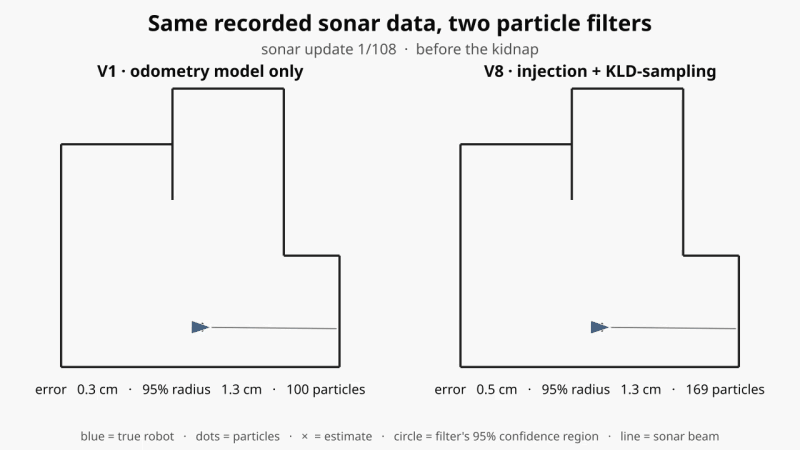
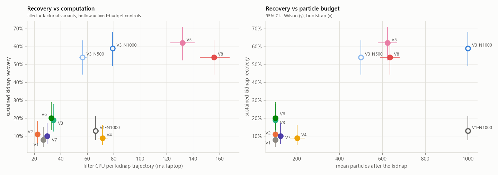
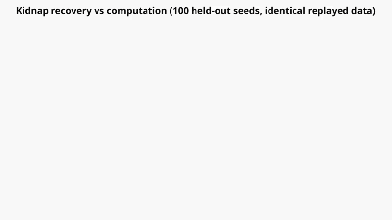
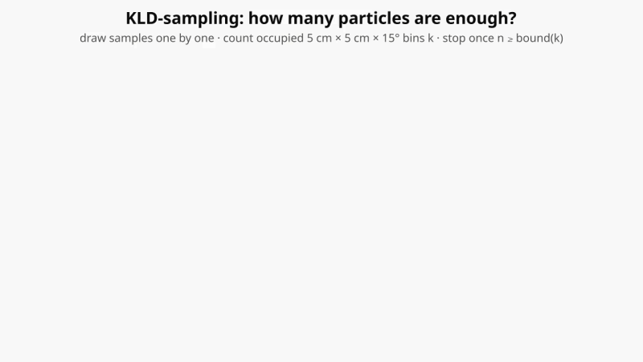
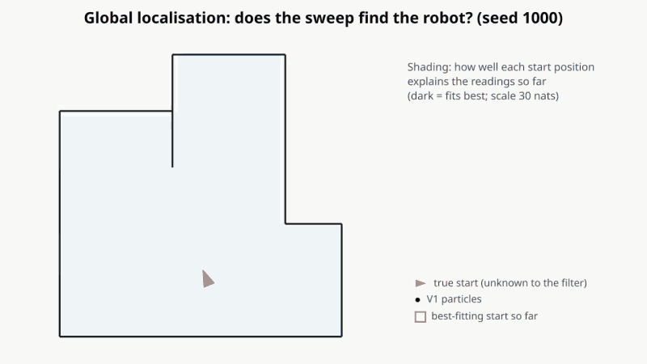

# lego-mcl-robot

Monte Carlo Localisation (MCL), camera-based obstacle avoidance and a controlled study of
particle-filter noise management, for a LEGO robot driven by a Raspberry Pi and a
BrickPi3. The same code runs on the robot or in the included simulator.


*The particle filter (red arrows) tracks the robot (blue path) around an 8-waypoint
course, using one forward-facing sonar and odometry.*

## What this is, and what is mine

**Original group coursework (Imperial College London robotics course, practicals 1–6).**
Our team wrote coursework scripts for:
- motion calibration
- bumper and sonar behaviours
- a particle filter and MCL
- camera homography and red-blob detection
- a DWA obstacle challenge

[docs/coursework_map.md](docs/coursework_map.md) maps each practical to the code here.

**My individual work after the course:**
- **Rewrite.** One unified package with a single parameter file
  ([config/robot.yaml](config/robot.yaml)) and several coursework bugs fixed.
- **Hardware abstraction and simulator.** Noisy odometry, a sonar with lost echoes and
  outliers, bumpers, and rendered camera frames, so every behaviour runs without the
  robot.
- **Tests.** An automated test suite, with every script smoke-tested in simulation.
- **The noise study** below:
  - a 2³ factorial design over three published techniques, with particle-budget controls
  - fixed-trajectory and closed-loop protocols
  - 100 held-out seeds
  - a corrected, incremental KLD-sampling implementation, profiled stage by stage
- **Not yet validated on hardware.** The refactor and the study have been validated in
  simulation only; the code has not been re-run on the physical robot since the rewrite.

## Noise study

**Question.** Under what conditions do ESS-gated resampling, augmented-MCL particle
injection and KLD-sampling improve localisation and recovery on a single-sonar robot?
And what do they cost in computation and closed-loop reliability?

All three are reimplemented from the literature and ROS AMCL; none is new.



*The same recorded run fed to two filters (seed 1000). After the robot is picked up and
moved, the baseline (left) stays confidently wrong: a tight cloud, a small confidence
circle, and 35 cm of error. Injection + KLD (right) spreads its particles, then recovers
to 1 cm.*



*Kidnap recovery (sustained < 10 cm) against filter CPU per trajectory and particle
budget, from 100 held-out seeds on identical replayed sensor data. Hollow markers are
fixed-budget controls.*

**Main findings** (simulation; 95% intervals in the report):

1. **The original "growing noise" was a bug.** The coursework rescaled its stored noise
   on every move. Once the motion model is fixed, every variant tracks the course to
   about 2 cm. The remaining accuracy differences (≤ 0.3 cm) are practically negligible.
2. **ESS-gated resampling is the only free improvement.** It resamples on 36% of updates
   instead of 100%, uses 13% less CPU, and leaves accuracy unchanged.
3. **Recovery from a kidnap needs injection *and* a large particle budget, and the
   budget is what matters.**
   - Injection + KLD: 54% sustained recovery, versus 8% for the baseline.
   - Injection with a *fixed* 1,000 particles: 59%.
   - Injection with a fixed 500 particles: 54%, at a third of the CPU of injection + KLD.
   - So the apparent injection × KLD "synergy" from my earlier exploratory study is
     explained by particle budget.
4. **KLD-sampling did not save time here.** Its per-sample bin bookkeeping took 40–48% of
   each update in this Python implementation, so fewer particles still meant slower
   updates. It saved CPU only in global localisation.
5. **Recovery-oriented filters destabilise closed-loop navigation.** With injection, the
   jumping estimate caused 13–17× more wall contacts after a kidnap. Injection mainly
   *bounds* catastrophic divergence; it doesn't improve the typical estimate.
6. **Narrow particle clouds can be confidently wrong.** After a kidnap, 19–72% of updates
   are "falsely confident", depending on the variant.
7. **Global localisation is unreliable with one sonar beam.** About half the failures
   are genuine sensor ambiguity. The other half are sampling failures, where the
   measurements identify the true start but the particle set never holds it.

**Animations** (made with ManimGX from the saved results; MP4s alongside the GIFs):

| Is it the technique or the particle budget? | How KLD-sampling picks a particle count | Global localisation: a valid hypothesis the particles miss |
|---|---|---|
|  |  |  |

Full report: **[docs/noise_study.md](docs/noise_study.md)**
- design, definitions, all 11 figures and the 4 animations
- statistics and threats to validity
- the pre-registered protocol: [PROTOCOL.md](experiments/noise_study/PROTOCOL.md)
- the original exploratory study: [legacy_v1/](experiments/noise_study/legacy_v1/)

## Other components

| Vision: calibrated floor grid | Vision: detected cans | DWA through random cans |
|---|---|---|
|  |  |  |

- **Vision:** a ground-plane homography from 4 floor/pixel correspondences, plus HSV
  segmentation that projects each red can's bottom edge to floor coordinates.
- **Planning:** a Dynamic Window Approach planner that drives 3 m through randomly placed
  cans using only the current camera frame.

## Reproduce

```bash
git clone https://github.com/efkontoes/lego-mcl-robot.git
cd lego-mcl-robot
python -m venv .venv && source .venv/bin/activate   # Windows: .venv\Scripts\activate
pip install -e ".[dev]"
pytest

python scripts/mcl_navigate.py --gif mcl.gif      # MCL on the course -> outputs/
python scripts/dwa_challenge.py --seed 3          # camera + DWA obstacle course -> outputs/

cd experiments/noise_study
python run_study.py all      # all simulation batches (~15 min, resumable)
python analyze.py            # tables and intervals from saved results
python make_figures.py       # figures from saved results

python animations/prepare_data.py   # animation data from saved results
python animations/render.py         # needs Python 3.13+ and pip install -e ".[animation]"
```

Rendering the animations needs a working GPU driver, or Linux/WSL, where ManimGX falls
back to CPU rendering. See
[animations/README.md](experiments/noise_study/animations/README.md).

The saved raw results are in the repository, so `analyze.py` and `make_figures.py` work
without rerunning the simulations. See
[experiments/noise_study/README.md](experiments/noise_study/README.md).

## Scripts

Every script takes `--backend sim` (default) or `--backend brickpi`.

| Script | Practical | What it does |
|---|---|---|
| `calibrate_motors.py` | 1 | Lets the wheels spin freely and prints encoder counts (hardware only) |
| `drive_square.py` | 1 | Drives a 40 cm square; in sim, repeats it and prints the end-point error covariance |
| `bumper_avoid.py` | 2 | Bumper-driven obstacle avoidance |
| `wall_follow.py` | 2 | Holds a set sonar distance with P-control on a moving average |
| `calibrate_sonar.py` | 2 | Sonar bias, spread and garbage rate at known distances → CSV |
| `mcl_navigate.py` | 3–4 | Waypoint navigation with MCL (`--variant`, default V2; `--interactive`, `--web`, `--gif`) |
| `camera_grid.py` | 5 | Overlays the homography's 10 cm floor grid to check the calibration |
| `red_blobs.py` | 5 | Detects red objects and prints their floor coordinates |
| `dwa_challenge.py` | 6 | Drives 3 m past red cans with camera + DWA (`--video` to record) |

## Layout

```
config/robot.yaml           every parameter, defined once
src/legobot/
  hardware/                 Backend protocol, BrickPi3 backend, simulator, vendored driver
  localisation/             map + ray casting, motion and sonar models, resampling, KLD, filter, variants
  vision/                   homography, red-blob detection, Pi camera, synthetic frames
  planning/dwa.py           Dynamic Window Approach
  navigation.py, behaviours.py, robot.py, calibration.py, viz/
scripts/                    one script per coursework task
experiments/noise_study/    study code, protocol, saved results, figures, legacy v1 study
tests/                      unit tests and simulated smoke tests of every script
docs/                       noise-study report, coursework map, media
```

## Running on the robot

Target setup: a Raspberry Pi with a BrickPi3 (firmware 1.4.x) and Python 3.9.

```bash
pip install -e ".[hw]"   # spidev, picamera2, opencv
python scripts/mcl_navigate.py --backend brickpi
```

Motor ports, wheel calibration and sonar offset are in `config/robot.yaml`.

`Robot.turn(+angle)` is counter-clockwise. The coursework's "left turn" convention was
the opposite, so if the robot spins the wrong way, swap `left_motor` and `right_motor` in
the config.

## Limitations

- All study results come from the simulator, whose noise is calibrated from practical 1
  measurements.
- The particle-filter parameters were developed on seeds 0–29 and then frozen.
- Timings are laptop measurements, not Raspberry Pi measurements.
- The KLD cost result reflects this Python implementation.
- One arena and one sensor layout were studied.

## Credits and license

Group coursework for the Imperial College London robotics course; rewrite, simulator,
tests and study by Efthymios Kontoes. The BrickPi3 driver in
`src/legobot/hardware/vendor/` is © Dexter Industries (MIT). This repository is MIT
licensed; see [LICENSE](LICENSE).
