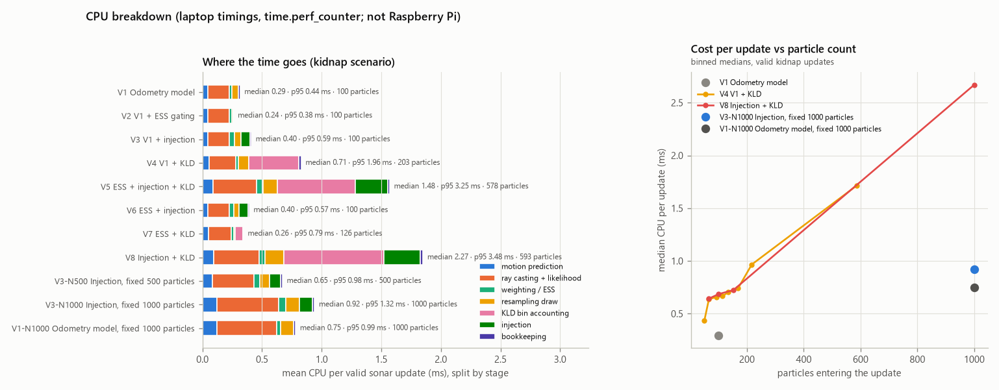
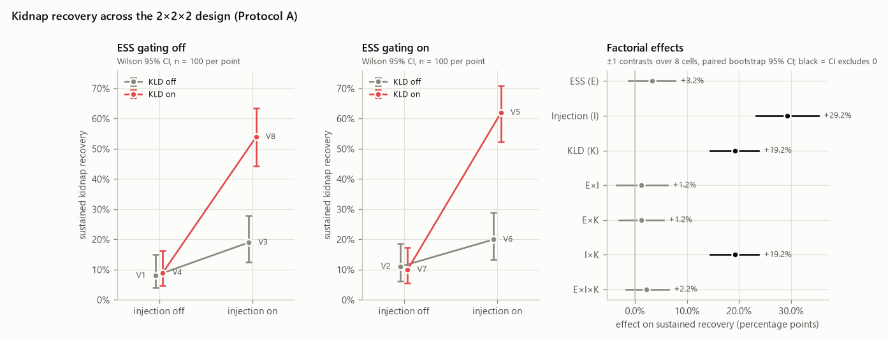
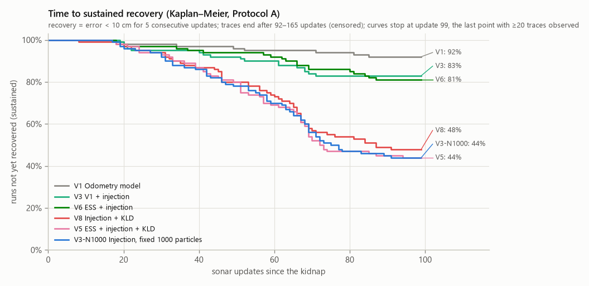
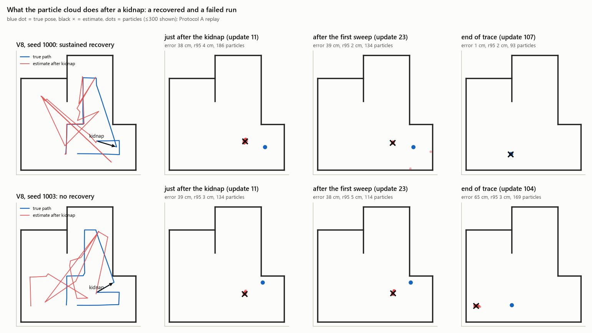
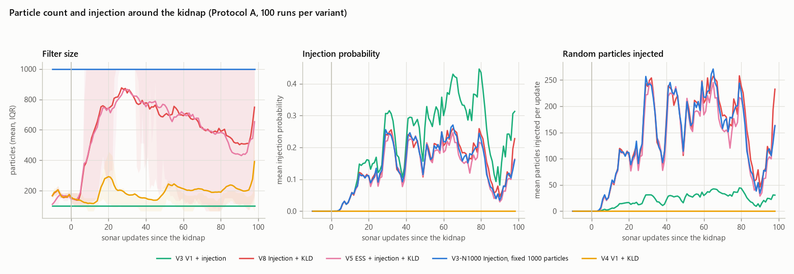
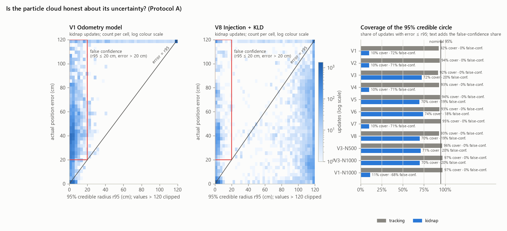
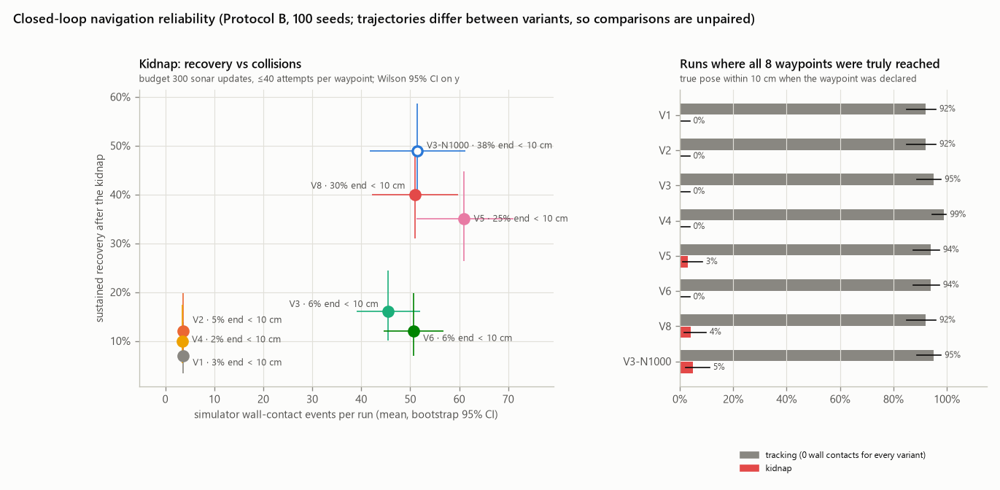
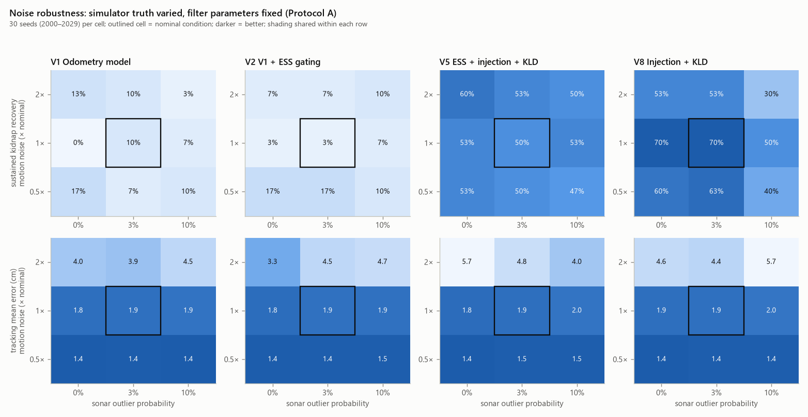
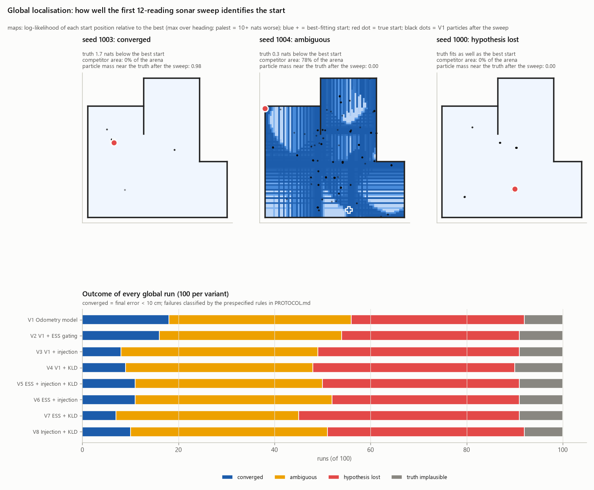

# Particle-filter noise management on a single-sonar LEGO robot

**Study version 2.0** (simulation only). The earlier exploratory study (v1) is preserved
unchanged in [`experiments/noise_study/legacy_v1/`](../experiments/noise_study/legacy_v1/).

**Research question.** Under what conditions do adaptive particle-filter techniques
(ESS-gated resampling, augmented-MCL particle injection and KLD-sampling) improve
localisation accuracy and recovery? And how do their interactions affect computation and
closed-loop navigation reliability?

**How to read this report.**
- Every number below comes from the saved results in `experiments/noise_study/results/`.
- [`results/analysis/summary.md`](../experiments/noise_study/results/analysis/summary.md)
  holds the full tables, with 95% intervals.
- The protocol was written down before the evaluation runs, in
  [`PROTOCOL.md`](../experiments/noise_study/PROTOCOL.md).
- Analyses added after seeing the results are labelled **exploratory**.
- Nothing here has been validated on the physical robot.

---

## 1. Problem and motivation

The robot is a LEGO differential drive on a Raspberry Pi with a BrickPi3. It localises in
a 210 × 210 cm walled arena using odometry and **one forward-facing ultrasonic sensor**
(σ ≈ 1.5 cm, trusted between 20 and 140 cm). It runs Monte Carlo Localisation (MCL)
[Dellaert et al. 1999]. A single range beam carries very little information per update,
so how the filter manages particle noise and diversity matters more here than on a
laser-equipped robot.

The study asks which of three standard techniques actually help this robot, under what
conditions, at what computational cost, and with what effect on the robot's behaviour
when the estimate drives it.

The techniques are reimplemented from the literature and from ROS AMCL; none of them
is new.

## 2. The noise-compounding bug and its correction

The coursework's waypoint script rescaled the stored motion-noise parameters by
`distance / 10` before every move, and the motion model then scaled them by
`distance / 10` again. With 20 cm steps, the noise standard deviation doubled on every
move.

In the v1 study this diverged in 30 of 30 runs. The particle spread reached the 10⁶ cm
logging cap within about 45 updates; see
[`legacy_v1/results/figures/spread_blowup.png`](../experiments/noise_study/legacy_v1/results/figures/spread_blowup.png).

The fix is simply that motion noise depends only on the current motion. The odometry
motion model below formalises this, and
`tests/test_motion_models.py::test_no_compounding_between_calls` guards against
regressions.

The bug was the original motivation for the study. It is **not** used as a baseline in
v2: every v2 variant uses the corrected motion model, so no technique is made to look
good by comparison with a broken filter.

## 3. Techniques and definitions

All factorial variants share the odometry motion model, the sonar model, the
initialisation and the pose estimator. Only the three factors below change.

**Odometry motion model (all variants)** [Thrun, Burgard & Fox 2005, Table 5.6; ROS
`amcl_odom.cpp`]. A motion is split into rot1, trans and rot2. Each part gets zero-mean
Gaussian noise whose variance is α-weighted, e.g.
σ²_trans = α₃·trans² + α₄·(rot1² + rot2²). The α values are fitted to the practical 1
calibration.

**Sonar model.** p(z | x) = 𝒩(z; ray-cast distance, 1.5²) + 0.001. The constant is a
floor so that one garbage reading can't zero out a correct particle. Readings outside
20–140 cm are ignored.

**Pose estimate.** The weighted mean of the particles within 25 cm of the weighted
median. This mirrors AMCL reporting its strongest cluster.

**E: ESS-gated resampling** [Kong, Liu & Wong 1994; Liu & Chen 1998].
N_eff = 1 / Σwᵢ². Resample only if N_eff < 0.5·N. Without gating, the filter resamples
after every valid update. Resampling is systematic (low variance) [Kitagawa 1996].

**I: augmented-MCL injection** [Thrun et al. 2001; Thrun, Burgard & Fox 2005, Table 8.3].
- Two running averages of the measurement likelihood: w_slow (rate 0.01) and w_fast
  (rate 0.1).
- At resampling, each particle is replaced by a uniformly random free-space pose with
  probability p = max(0, 1 − w_fast / (η·w_slow)), with η = 0.5.
- Three adaptations for a single sonar beam (from v1, frozen before v2):
  1. Both averages are seeded from the first measurement.
  2. Particles injected at the previous step are excluded from the likelihood average.
     Otherwise there is a runaway feedback loop: injected particles score low, which
     lowers the average, which triggers more injection.
  3. η = 0.5 rather than 1, chosen on 12 development seeds in v1.

**K: KLD-sampling** [Fox 2001; Fox 2003].
- The sample size satisfies n ≥ (k−1)/(2ε) · (1 − 2/(9(k−1)) + √(2/(9(k−1)))·z)³, where
  k is the number of occupied bins (5 cm × 5 cm × 15°).
- Parameters: ε = 0.05, z₀.₉₉ = 2.326, with n between n_min = 50 and n_max = 1000. One
  occupied bin needs exactly n_min particles.

**KLD correction in v2.**
- **What v1 did:** it drew n_max = 1000 candidates by systematic resampling, shuffled
  them, and truncated at the bound. That costs work proportional to n_max on every
  update and is not Fox's procedure.
- **What v2 does** (`kld.py::kld_resample`): it draws i.i.d. samples from the weights,
  applies injection to each draw, updates the bin count, and stops at the first n that
  satisfies the bound.
  - For speed the draws are generated in chunks.
  - Because the samples are i.i.d., truncating a chunk at the stopping point gives the
    same distribution as drawing one at a time, deterministically for a given seed.
  - `tests/test_kld.py` checks that the returned n is the *first* count satisfying the
    rule.
- **Consequence:** v1 and v2 KLD timings are not comparable.

**Diagnostics** (computed per update and logged; not part of the timed filter code):
- **N_eff/N** before resampling.
- **Occupied bins.**
- **Unique-pose fraction:** the share of current particle poses that are unique. This is
  weak evidence of diversity, because duplicates become distinct after one noisy
  prediction.
- **Lineage fraction:** distinct ancestors from the last 5 *resampling events*, divided
  by N.
- **Injection probability and particles injected.**
- **Particle count** before and after resampling.
- **95% credible radius r95:** the radius around the estimate containing 95% of the
  particle weight.
- **Coverage:** the share of updates with error ≤ r95.
- **False confidence:** r95 ≤ 20 cm **and** error > 20 cm.

## 4. Experimental design and controls

**Variants.** A complete 2³ factorial design (V1–V8), plus fixed-budget controls:

| | ESS (E) | Injection (I) | KLD (K) | Particles |
|---|---|---|---|---|
| V1 | – | – | – | 100 |
| V2 | ✓ | – | – | 100 |
| V3 | – | ✓ | – | 100 |
| V4 | – | – | ✓ | adaptive 50–1000 |
| V5 | ✓ | ✓ | ✓ | adaptive |
| V6 | ✓ | ✓ | – | 100 |
| V7 | ✓ | – | ✓ | adaptive |
| V8 | – | ✓ | ✓ | adaptive |
| V3-N500 / V3-N1000 | – | ✓ | – | fixed 500 / 1000 |
| V1-N1000 | – | – | – | fixed 1000 |

V0, the coursework motion model with the bug fixed, appears in tracking only, as a
historical control.

**Protocol A: fixed-trajectory replay.** This is the basis of every estimator claim.
- For each seed, a *reference trace* is generated by a controller that steers using the
  **true** pose, so no filter influences it.
- The trace records every commanded motion, every sonar reading (or "no echo"), the true
  pose and the simulated time.
- Every variant is fed the identical event sequence. Each filter's own sampling is
  stochastic but seeded.
- **Scenarios:**
  - **Tracking:** 8-waypoint course from a known start; about 40–70 sonar updates per
    trace.
  - **Kidnap:** the same course, but after waypoint 3 the robot is moved 30–50 cm and
    rotated up to ±45°. It then does a 12-step sonar sweep at waypoint 3 and every later
    waypoint. Each trace has 92–165 post-kidnap updates.
  - **Global:** an unknown start with 1,000 initial particles for every variant, then
    4 cycles of a sweep plus a short move.
- **Seeds:** 1000–1099, held out from all development and tuning.

**Protocol B: closed-loop navigation.**
- The estimate drives the robot, so trajectories, motion noise and sonar readings
  diverge between variants. Comparisons are therefore **unpaired**.
- **Fixed budget:** 150 sonar updates (tracking) or 300 (kidnap), and at most 40
  attempts per waypoint. A failing variant does not get unlimited extra chances.
- **Variants:** V1, V2, V3, V4, V5, V6, V8 and V3-N1000, chosen before the runs. Seeds
  1000–1099.

**Noise grid** (Protocol A).
- The simulator's motion noise is set to 0.5×, 1× or 2× nominal, crossed with sonar
  outlier probability 0%, 3% or 10%. Filter parameters stay at nominal.
- **Coverage:** variants V1, V2, V5 and V8; tracking and kidnap; 30 seeds (2000–2029)
  per cell.

**Outcomes.**
- **Kidnap, primary:** **sustained recovery**, meaning error < 10 cm for ≥ 5 consecutive
  updates after the kidnap, within the trace horizon. Runs that never recover are
  censored at the horizon.
- **Kidnap, also reported:** the v1 metric (final error < 10 cm), "dipped below 10 cm at
  least once", time to recovery, and post-kidnap error.
- **Tracking:** mean position error.
- **Cost:** filter CPU per trajectory (`time.perf_counter`, prediction + update).
  - Machine: a Windows 11 laptop with an Intel Core (Family 6 Model 142) CPU, 8 logical
    cores, Python 3.14.2 and NumPy 2.5.4, recorded in `results/metadata/`.
  - **These are not Raspberry Pi timings.**

**Statistics.**
- Proportions: Wilson 95% intervals.
- Paired Protocol A differences: bootstrap over seeds (10,000 resamples).
- Factorial effects: ±1 contrasts over the 8 cell means, with a paired bootstrap.
- Closed-loop means: unpaired bootstrap.

**Prespecified decision rule.** An injection × KLD *synergy* is claimed only if the I×K
contrast excludes 0 **and** V8 beats the matched-budget control.

**Execution and provenance.**
- Each batch was run exactly once: traces 14 s, main 289 s, closed loop 138 s, noise
  grid 285 s, global diagnostic 188 s.
- No simulation was repeated to make figures.
- The runs used the working tree on top of commit `df03434`, before the v2 changes were
  committed. The metadata records this as `dirty: yes`.
- Analysis code was extended after the first look at the results (robust error summaries,
  runaway analysis, Kaplan–Meier truncation). Those additions are marked exploratory.

## 5. Accuracy and efficiency

**Tracking accuracy is a tie** (`summary.md`, Protocol A tracking).
- Every variant has a mean error between 1.86 and 2.16 cm, and 98–100% of runs end
  within 10 cm.
- Of the 7 factorial contrasts on tracking error, only one has a CI excluding 0: E×I,
  −0.06 cm, CI [−0.13, −0.002]. It is marginal and far below the sonar's resolution, and
  reads best as noise.
- The only robust accuracy difference comes from more particles: V1-N1000 is 0.15 cm
  better than V1 (CI [−0.23, −0.08]). That is statistically clear and practically
  negligible.

**ESS gating is the one free improvement in cost.**
- In tracking it resamples on 36% of valid updates instead of 100%.
- That cuts CPU per trajectory by 13% (9.1 → 7.9 ms; −1.2 ms, CI [−1.3, −1.1]).
- Accuracy is unchanged (−0.03 cm, CI [−0.12, 0.05]).
- The unique-pose fraction rises from 0.76 to 0.84. But the lineage fraction *falls*
  (0.28 → 0.24), because its window counts resampling events, and under gating 5
  resamples span about 3× more updates. The diversity gain is real but modest, and the
  two diversity metrics answer different questions.

**KLD-sampling does not reduce computation on this robot, even with fewer particles**
(Figure 7; `cpu_stages.csv`).

- **Per-update cost in the kidnap scenario** (median):

  | Variant | Particles | Median CPU per update |
  |---|---|---|
  | V1 | 100 | 0.29 ms |
  | V4 | about 200 | 0.72 ms |
  | V3-N1000 | 1000 | 0.92 ms |
  | V8 | about 590 | 2.27 ms |

- **Where KLD's time goes:** bin accounting takes 40–48% of every KLD update. That is the
  per-sample histogram encoding and new-bin bookkeeping in `kld_resample`. On top of it,
  the chunked sampler issues several small NumPy calls per update.
- **What scales with particles:** ray casting grows about linearly, from 0.18 ms at 100
  particles to 0.52 ms at 1000.
- **Conclusion:** with this vectorised Python implementation, KLD's bookkeeping costs
  more than the particles it saves, at every particle count we observed.
- **In global localisation** KLD does save time: V5 and V7 are about 40% cheaper than V1
  there. That's because it drops from 1,000 to about 180 particles on average and
  bookkeeping is a smaller share.
- **Caveat:** this is an implementation-level result. A compiled implementation (as in
  AMCL's C code) has a far smaller per-sample bookkeeping cost, and the balance could
  reverse.

## 6. Ablation and interaction analysis

**Factorial effects on sustained kidnap recovery** (`factorial_effects.csv`, ±1
contrasts, 95% paired bootstrap CI):

| Effect | Estimate | 95% CI |
|---|---|---|
| Injection (I) | **+29.2 pp** | [+23.2, +35.3] |
| KLD (K) | **+19.2 pp** | [+14.5, +23.8] |
| I × K | **+19.2 pp** | [+14.5, +23.7] |
| ESS (E) | +3.2 pp | [−1.2, +7.8] |
| E×I, E×K, E×I×K | ≤ 2.2 pp | all CIs include 0 |

- **On its face, a strong injection × KLD interaction.**
  - Injection adds 11 pp without KLD: V3 − V1 = 19% − 8%, CI [+2, +20].
  - It adds 45 pp with KLD: V8 − V4 = 54% − 9%, CI [+34, +56].
  - The difference between those two is +34 pp, CI [+21, +47].
  - KLD alone does nothing: V4 − V1 = +1 pp, CI [−2, +5].
- **The budget controls explain it** (Figure 3; `paired_comparisons.csv`):

  | Comparison | Recovery | CPU per kidnap trajectory | Particles |
  |---|---|---|---|
  | V8 vs V3-N500 | 54% vs 54% (0 pp, CI [−13, +13]) | 156 vs 56 ms | 589 vs 500 |
  | V8 vs V3-N1000 | 54% vs 59% (−5 pp, CI [−18, +9]) | 156 vs 79 ms | 589 vs 1000 |
  | V3-N1000 vs V3 | **+40 pp** (CI [+28, +52]) | | 1000 vs 100 |
  | V1-N1000 vs V1 | +5 pp (CI [0, +11]) | | 1000 vs 100 |

- **Interpretation.** Injection needs a large particle set. The random poses need
  somewhere to live long enough to be weighted by the sweeps.
  - KLD supplies that set adaptively: KLD filters grow to the 1,000 cap after injection
    widens the cloud (Figure 6).
  - A fixed 500–1000-particle injection filter supplies the same thing at a third to a
    half of the CPU.
  - Particles without injection don't help (V1-N1000).
- **Verdict under the prespecified rule:** I×K is "significant", but V8 does not beat the
  matched-budget control. **The interaction reflects particle budget, not a synergy
  between the techniques.**

**ESS gating has no measurable effect on recovery.**
- V6 − V3 = +1 pp (CI [−9, +11]).
- V5 − V8 = +8 pp (CI [−5, +21]).
- It does make V5 cheaper than V8 (−24 ms per trajectory, CI [−37, −12]), because about
  35% of V5's updates skip resampling.

## 7. Kidnapping recovery and failure behaviour

**Recovery metrics disagree, and the differences matter** (`summary.md`, Protocol A
kidnap; n = 100 each):

| Variant | Sustained recovery | Final < 10 cm (v1 metric) | Dipped below 10 cm at least once |
|---|---|---|---|
| V1 | 8% [4, 15] | 4% [2, 10] | 19% |
| V3 | 19% [13, 28] | 8% [4, 15] | 89% |
| V8 | 54% [44, 63] | 38% [29, 48] | 93% |
| V5 | 62% [52, 71] | 45% [36, 55] | 92% |
| V3-N1000 | 59% [49, 68] | 36% [27, 46] | 92% |

- Injection filters touch the right answer in about 90% of runs. With only 100 particles
  (V3), that is mostly brief contact, not recovery.
- The v1 metric (final error) is 10–25 pp lower than sustained recovery because
  recoveries **relapse**: 17 of V5's 62 sustained recoveries, 18 of V8's 54 and 24 of
  V3-N1000's 59 were back above 10 cm at the final update (`main_runs.csv`).
- Final-error success without a sustained recovery is rare (0–2 runs per variant).
- A sustained recovery is therefore not a permanent one, and neither metric alone
  describes the outcome.

**Time to recovery** (Figure 4, Kaplan–Meier, runs censored at their trace horizon).

- At update 99 after the kidnap (the last point where at least 20 traces are still
  observed), these are not yet recovered:

  | Variant | Not yet recovered |
  |---|---|
  | V5 | 44% |
  | V3-N1000 | 44% |
  | V8 | 48% |
  | V6 | 81% |
  | V3 | 83% |
  | V1 | 92% |

- The large-budget injection filters are indistinguishable over the whole time course.
- Recoveries begin about 20 updates after the kidnap, i.e. after the first full sonar
  sweep.

**Runaway estimates** (exploratory; `kidnap_runaway_duration.csv`,
`kidnap_robust_error.csv`).
- Mean post-kidnap error suggests injection halves the error (117 → 63 cm). That mean is
  dominated by a few runs.
- The estimate leaves the arena (error > 300 cm) at least once in a similar share of
  runs for every variant: 5–8 of 100.
- **Without injection** those runaways are permanent: 82% of post-kidnap updates are over
  3 m off, and the final error is about 15 m. Nothing pulls particles back into free
  space once every particle sits on the likelihood floor.
- **With injection** they end: about 18% of updates are over 3 m, and the final error is
  55–80 cm.
- The *typical* run barely differs. The median over runs of the post-kidnap median error
  is 41 cm for V1, 46 cm for V3 and 39–40 cm for V8 and V3-N1000. Within that, V3 is
  6 cm *worse* than V3-N1000 (CI [−8.4, −1.7] for V3-N1000 − V3).
- **Conclusion:** injection's main contribution is to **bound catastrophic divergence**,
  not to make the typical estimate more accurate.

**What the particle cloud does** (Figures 5 and 6).

- Right after the kidnap, every filter is **falsely confident**: in both examples the
  error is about 38 cm with r95 of 3–4 cm.
- In the recovered run, the cloud stays confidently wrong through the first sweep and
  only locks onto the correct pose later in the trace.
- In the failed run, it ends 65 cm off with r95 = 3 cm.
- Figure 6 shows the mechanism behind §6. Injection probability rises to 0.2–0.4 after
  the kidnap.
  - V3 can inject only 10–40 particles per update.
  - V8, V5 and V3-N1000 inject 100–250 per update, and KLD variants grow to the
    1,000-particle cap within about 20 updates.

**Uncertainty calibration** (Figure 10; `uncertainty.csv`).
- **Tracking:** the 95% credible circle covers the truth on 92–97% of updates, and false
  confidence is essentially absent (≤ 0.1%).
- **Kidnap without injection:** coverage collapses to about 10%, and 68–72% of all kidnap
  updates are falsely confident.
- **Kidnap with injection:** coverage rises to about 70%, but about 19% of updates are
  still falsely confident.
- **Global:** 43–58% of updates are falsely confident.
- **Conclusion:** a narrow particle cloud is not evidence of correct localisation after a
  disturbance.

## 8. Closed-loop navigation reliability (Protocol B)

**Tracking:** every variant completes the course. 92–99% of runs truly reach all 8
waypoints (true pose within 10 cm when the waypoint is declared), with **0 wall
contacts** and about 79 s of simulated time for every variant.

**Kidnap:** recovery-oriented configurations destabilise navigation.

| Variant | Sustained recovery | Wall contacts per run | All 8 waypoints truly reached | Simulated time |
|---|---|---|---|---|
| V1, V2, V4 | 7–12% | 3.4–3.6 | 0% | about 144 s |
| V3-N1000 | 49% [39, 59] | 51 | 5% | about 290 s |
| V8 | 40% [31, 50] | 51 | 4% | about 300 s |
| V5 | 35% [26, 45] | 61 | 3% | about 310 s |

- **Without injection** the robot confidently drives the rest of the course on a wrong
  belief. It declares all 8 waypoints reached, but only about 3.1 of them truly (roughly
  the 3 before the kidnap), and it rarely hits a wall.
- With injection, about 3.8–4.1 waypoints are truly reached.
- **With injection** the estimate jumps between hypotheses, so the navigation controller
  issues turns and drives toward walls. Every injection variant has about 13–17× more
  wall contacts, gives up on about 1.0–1.4 waypoints per run (the attempt cap), and takes
  twice as long. The 300-update budget was never exhausted.
- **Ranking:** closed-loop recovery follows the Protocol A ranking, with V3-N1000 ≥ V8 ≥
  V5 ≫ V1. V5 has the most collisions.
- **For physical deployment**, this is a strong argument for *gating navigation on
  localisation confidence* (stop and sweep until recovered) rather than for adopting V5
  as-is. The policy wasn't tested here.

## 9. Sensitivity to noise-model mismatch

Thirty seeds per cell, so each recovery proportion carries about ±17 pp of uncertainty.
These results are descriptive.

- **Recovery ranking holds in all 9 conditions.** V5 and V8 recover in 30–70% of runs;
  V1 and V2 in 0–17%. Recovery barely depends on motion noise in the 0.5×–2× range.
- **V8 may be sensitive to outliers.** At 10% sonar outliers V8 drops in every motion row
  (70 → 50, 63 → 40, 53 → 30%), while V5 stays at 47–53%. This is consistent with ESS
  gating damping injection triggered by spurious readings, but it rests on 30 seeds and
  is a hypothesis, not a finding.
- **Tracking error scales with true motion noise** for every variant: about 1.4 cm at
  0.5×, about 1.9 cm at 1×, and 3.3–5.7 cm at 2×. Failures (final error ≥ 10 cm) reach
  7–27% at 2×.
- At 2× motion noise no variant is clearly better; the CIs overlap.
- The filters' motion model is fixed at nominal noise, so 2× noise is under-modelled for
  all of them alike.

## 10. Global-localisation limitations

**Global success is low for every variant.** Sustained convergence is 10–21%, e.g. V1
20% [13, 29] and V2 21%. KLD reduces it slightly: K main effect −4.5 pp, CI [−8.8, −0.2].
That's consistent with KLD shrinking confidently onto wrong hypotheses.

The v2 numbers are higher than v1's 3–7% because the global traces differ: the
ground-truth controller produces different sweeps and moves. Old and new values are not
comparable.

**Is the sensor to blame?** The prespecified diagnostic evaluates the likelihood of the
first 12-reading sweep over every start pose on a 2.5 cm × 5° grid
(`raw/global_diag/global_diag.csv.gz`).

- **The truth is plausible in 90 of 100 traces** (within a factor of 100 of the
  best-fitting start).
- **Ambiguous in 50 of 100:** some start more than 20 cm away fits nearly as well
  (within a factor of 10).
- **Unambiguous and plausible in 48 of 100:** the sweep identifies the true start, yet
  V1 converges in only 12 of those 48, and V5 and V8 in 7.
  - The median particle mass near the truth after the sweep is **0.00** in these cases.
  - 1,000 uniform particles almost never place one close enough to the truth to survive
    a σ = 1.5 cm likelihood.

**Conclusion:** about half of the global failures stem from genuine sensor ambiguity.
The other half are **sampling failures**: a valid hypothesis exists, but the particle set
never holds it. Single-beam sensing is part of the explanation, not all of it. Plausible
remedies were not tested:
- likelihood tempering during the first sweep
- seeding particles from the measurement (sensor-resetting localisation, Lenser &
  Veloso 2000)
- a denser initial set

Under the tested conditions, global localisation should be treated as **unreliable**.

## 11. Statistical uncertainty and threats to validity

- **Simulation only.** The simulator's noise is set from the practical 1 calibration.
  No result here has been checked on the robot.
- **One arena and one sensor layout.** The arena geometry produces the ambiguity
  structure in §10.
- **Development parameters.** Injection η = 0.5, the w_slow/w_fast rates and the cluster
  radius were tuned in v1 on seeds 0–29 (12 seeds for η). They were frozen before v2 and
  never tuned on the evaluation seeds 1000–1099 or 2000–2029.
- **Multiple comparisons.** 49 factorial contrasts and about 100 paired comparisons are
  reported without correction. Isolated marginal effects (e.g. tracking E×I, global K)
  should be read with that in mind. The headline effects (I, K, I×K on recovery;
  V3-N1000 − V3; ESS cost reduction) have CIs far from 0.
- **Closed loop is unpaired.** Trajectories diverge, so Protocol B intervals are wider
  and differences partly reflect different robot paths.
- **Kaplan–Meier tails.** Trace horizons vary (92–165 updates). Curves are truncated
  where fewer than 20 traces remain; the truncation point was chosen after seeing the
  data.
- **Timing.** Laptop wall-clock (`perf_counter`), single process, all variants
  interleaved within each 10-seed block. The KLD cost conclusion applies to *this* Python
  implementation.
- **Lineage metric.** Its window counts resampling events, not updates, so it is not
  comparable between gated and ungated filters.
- **Exploratory additions** (after the first look at the results): robust median and
  runaway analyses, the Kaplan–Meier truncation, and the noise-grid interpretation.

## 12. Engineering conclusions and future work

What the evidence supports, with the section it comes from:

1. **Fix the motion model first** (§2). The original "growing noise" was a bug. Once it
   is fixed, every variant tracks the course to about 2 cm.
2. **Use ESS-gated resampling** (§5). It is the only technique with a clear benefit at no
   cost: 13% less CPU in tracking, unchanged accuracy, and higher unique-pose diversity.
3. **For kidnap recovery, use injection with a large particle budget** (§6, §7). It
   recovers in about 55–60% of runs within the horizon, against 8% for the baseline.
   The benefit comes from the budget: a fixed 500–1000-particle injection filter matches
   V5 and V8 at a third to half the CPU. **The injection × KLD "synergy" reported in v1
   is not supported.**
4. **KLD-sampling, as implemented here, is not worth it for tracking or kidnap** (§5). It
   saves CPU only in global localisation, and it slightly lowers global success.
5. **Injection bounds divergence rather than improving typical accuracy** (§7), and in
   closed loop it causes 13–17× more wall contacts (§8). Any deployment should stop the
   robot and sweep until the filter is confident again, not keep navigating on a jumping
   estimate.
6. **Don't trust a narrow particle cloud after a disturbance** (§7). False confidence
   affects about 19% of post-kidnap updates even with injection, and about 70% without
   it.
7. **Global localisation is unreliable** with this sensing (§10), and half of its
   failures are sampling failures.

**Recommended configuration for this robot (simulation evidence only):**
- **V2 (odometry model + ESS gating)** for normal navigation. It is now the default in
  `mcl_navigate.py`.
- **Injection with a fixed 500–1000-particle budget**, combined with a stop-and-sweep
  recovery behaviour, for situations where the robot may be moved. This combination is
  untested.
- **Not V5 as-is.** Its recovery advantage over the cheaper control is nil, and its
  closed-loop collision rate is the highest.

**Future work:**
- Validate on the physical robot, particularly the recovery and collision findings.
- Test a confidence-gated navigation policy.
- Try sensor-resetting or measurement-driven injection for global localisation.
- Write a compiled KLD to separate algorithmic from interpreter cost.

## References

1. F. Dellaert, D. Fox, W. Burgard, S. Thrun. *Monte Carlo Localization for Mobile Robots.* ICRA 1999.
2. S. Thrun, W. Burgard, D. Fox. *Probabilistic Robotics.* MIT Press, 2005 (Tables 4.4, 5.6, 8.3).
3. A. Kong, J. S. Liu, W. H. Wong. *Sequential Imputations and Bayesian Missing Data Problems.* JASA 89(425), 1994.
4. J. S. Liu, R. Chen. *Sequential Monte Carlo Methods for Dynamic Systems.* JASA 93(443), 1998.
5. G. Kitagawa. *Monte Carlo Filter and Smoother for Non-Gaussian Nonlinear State Space Models.* JCGS 5(1), 1996.
6. S. Thrun, D. Fox, W. Burgard, F. Dellaert. *Robust Monte Carlo Localization for Mobile Robots.* Artificial Intelligence 128(1–2), 2001.
7. J.-S. Gutmann, D. Fox. *An Experimental Comparison of Localization Methods Continued.* IROS 2002.
8. D. Fox. *KLD-Sampling: Adaptive Particle Filters.* NIPS 2001.
9. D. Fox. *Adapting the Sample Size in Particle Filters Through KLD-Sampling.* IJRR 22(12), 2003.
10. S. Lenser, M. Veloso. *Sensor Resetting Localization for Poorly Modelled Mobile Robots.* ICRA 2000.

Reference implementations: ROS navigation `amcl` (`amcl_odom.cpp`, `pf/pf.c`) and
PythonRobotics `particle_filter.py`.
