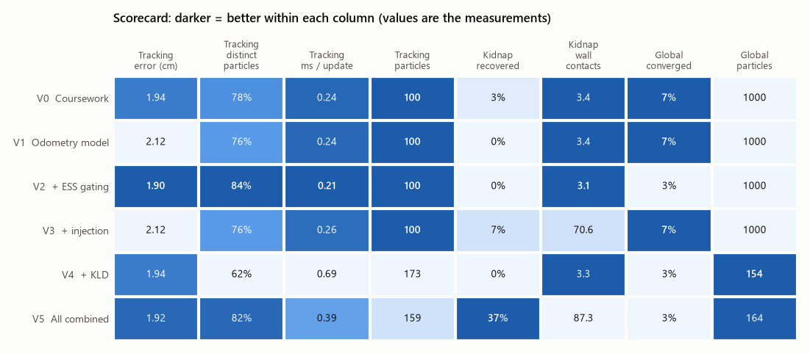
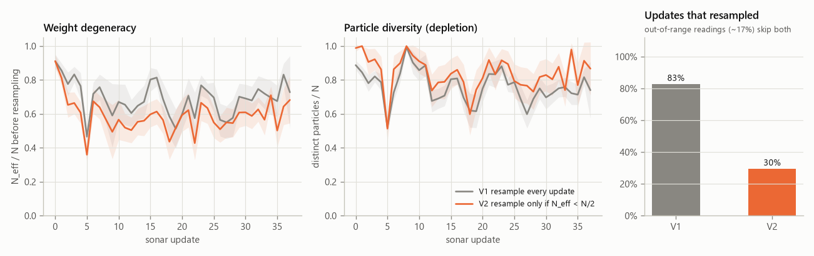
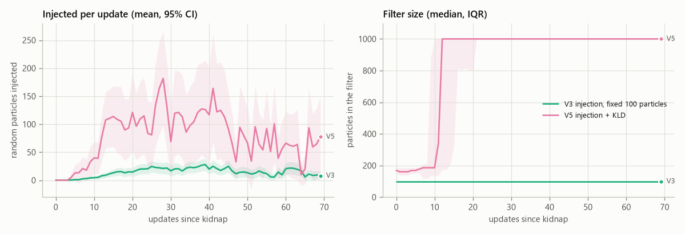
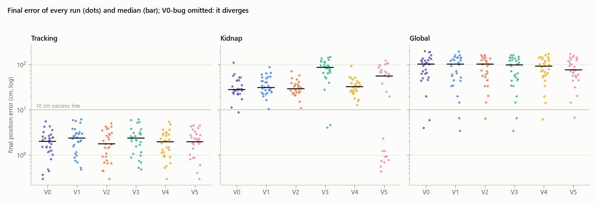

# Noise study: fixing particle-cloud blow-up and depletion in MCL

This study started from a bug in the original coursework. Our waypoint-navigation
script made the particle cloud spread wider and wider until localisation was useless.
That raised the question of how well-known particle-filter implementations keep their
noise under control. The study reimplements four techniques from the literature, in the
form ROS AMCL and PythonRobotics use them. It then compares them on the coursework robot
in simulation: 3 scenarios × 7 filter variants × 30 seeds.

Reproduce everything with:

```bash
python experiments/noise_study/run_benchmark.py   # ~40 s, writes results/*.csv
python experiments/noise_study/make_figures.py    # figures + results/summary.md
```

## 1. The original problem

The coursework `ParticleManager` scaled its motion noise by the distance driven: a
standard deviation `sigma_e` per 10 cm, multiplied by `D / 10`. The waypoint script
*also* rescaled the stored parameters before every move:

```python
pm.sigma_e = pm.sigma_e * (dist / 10)   # overwrites the model parameter...
pm.sigma_f = pm.sigma_f * (dist / 10)
pm.update_straight(dist)                # ...which then scales by dist/10 again
```

With 20 cm steps, the noise standard deviation doubles on *every* move (×2ⁿ after n
moves). In simulation this variant (`V0-bug`) diverges in 30/30 runs. Its particle spread
hits the 10⁶ cm cap within about 45 updates, while every corrected variant stays at a few
centimetres:


The general lesson, and the first technique below: **motion noise must depend only on
the motion being applied, never on state that accumulates between calls.**

## 2. Techniques compared

| Key | Variant | What changes | Imitated from | Paper |
|---|---|---|---|---|
| V0-bug | Coursework + bug | Coursework model with the compounding parameters | (original code) | n/a |
| V0 | Coursework model | Std scaled by distance; *fixed* turn noise; resample every update | (original code, bug removed) | n/a |
| V1 | Odometry motion model | Motion = rot1, trans, rot2; variance = α-weighted sum of squared rotation/translation | ROS `amcl_odom.cpp` (`ODOM_MODEL_DIFF`) | [2] Table 5.6 |
| V2 | V1 + ESS-gated resampling | Resample only when N_eff = 1/Σwᵢ² < N/2; low-variance (systematic) resampler | PythonRobotics `particle_filter.py` (`NTh = NP/2`), AMCL `pf.c` | [3], [4], [5] |
| V3 | V1 + augmented MCL | Track w_slow, w_fast; inject random poses with p = max(0, 1 − w_fast/(η·w_slow)) | AMCL `pf.c` (`pf_update_resample`) | [2] Table 8.3, [6], [7] |
| V4 | V1 + KLD-sampling | Particle count from the number of occupied (x, y, θ) bins | AMCL `pf_resample_limit` | [8], [9] |
| V5 | All combined | V1 + V2 + V3 + V4 | n/a | n/a |

Code: [`motion_models.py`](../../../src/legobot/localisation/motion_models.py),
[`resampling.py`](../../../src/legobot/localisation/resampling.py),
[`kld.py`](../../../src/legobot/localisation/kld.py),
[`particle_filter.py`](../../../src/legobot/localisation/particle_filter.py).

### Odometry motion model (V1)
From `sample_motion_model_odometry` [2]:

```
rot1'  = rot1  + N(0, a1·rot1² + a2·trans²)
trans' = trans + N(0, a3·trans² + a4·(rot1² + rot2²))
rot2'  = rot2  + N(0, a1·rot2² + a2·trans²)
```

The α values are fitted to the same practical 1 calibration as the coursework sigmas
(0.3 cm and 0.01 rad per 10 cm, 0.02 rad per 90° turn). The structural difference from V0
is that a 10° heading correction now adds 9× less rotation noise than a 90° turn, instead
of the same amount.

### ESS-gated, low-variance resampling (V2)
Resampling every update replaces informative weights with duplicates (particle
depletion). The effective sample size N_eff = 1/Σwᵢ² [3, 4] measures weight degeneracy.
We resample only when it drops below N/2, as PythonRobotics and AMCL's selective
resampling do. The resampler is the systematic / low-variance one [5]: one random offset
and N evenly spaced pointers. It was rewritten with `searchsorted` and a guard on the
last cumulative weight, which removes an index overflow the coursework loop could hit
through floating-point round-off.

### Augmented MCL: random particle injection (V3)
Two exponential averages of the measurement likelihood are tracked: `w_slow` (rate
0.01) and `w_fast` (rate 0.1). When recent measurements fit much worse than usual,
`w_fast` falls below `w_slow`, and that fraction of resampled particles is replaced by
uniformly random poses in free space [2, 6].

**What we had to change for a single sonar beam:**

1. **Seeding.** AMCL starts both averages at 0. That means `w_slow` needs hundreds of
   updates before injection can ever trigger, so we seed both from the first measurement.
2. **A feedback loop.** Injected particles almost always score at the likelihood floor.
   Counting them in `w_avg` lowers `w_fast`, which injects more particles, and so on. In
   a traced run, 30–44% of the particles were being replaced on every update. Particles
   injected at the previous step therefore don't vote.
3. **A threshold η = 0.5.** One beam's average likelihood fluctuates far more than a
   laser scan's, so the textbook rule (η = 1) fires constantly. In a 12-seed tuning run,
   η = 1 injected about 1,028 particles per tracking run; η = 0.5 injected about 9.
4. **The estimate.** Like AMCL, which reports its highest-weight cluster, the pose
   estimate is the mean of the particles within 25 cm of the weighted median. A minority
   of stray particles can't drag it away. Every variant uses the same estimator.

### KLD-sampling (V4)
Fox's bound [8, 9] sets the particle count from the number of occupied histogram bins
(5 cm × 5 cm × 15° here): ε = 0.05, δ = 0.01, between 50 and 1000 particles. Samples are
drawn in random order until the bound for the bins seen so far is met.

## 3. Scenarios

All scenarios use the practical 4 arena and the coursework sensing: one forward-facing
sonar with σ = 1.5 cm, trusted between 20 and 140 cm. The simulated robot's true noise
comes from the practical 1 calibration plus a small constant per turn that no filter
models. Its sonar loses echoes at steep incidence and returns 3% random outliers.
Seeds are fixed, so runs are reproducible.

- **Tracking:** known start, then drive the 8-waypoint practical 4 course (turn, then
  drive at most 20 cm, then one sonar update).
- **Kidnap:** the same course, but after waypoint 3 the robot is moved 30–50 cm and
  rotated up to ±45°. Afterwards it does a 12-step sonar sweep at every waypoint.
- **Global:** unknown start, uniform particles (1,000 for fixed-size filters). Four cycles
  of a 12-step sweep followed by a short move.

"Success" means the final position error is under 10 cm.

## 4. Results (30 seeds per cell)

### Scorecard

Each column is shaded relative to the other variants: darker means better on that
metric. The numbers are the actual measurements.



### What each technique buys and what it costs

Each point is one variant, averaged over 30 runs.

- **Tracking:** every variant is accurate to within 0.25 cm, so the differences that
  matter are in cost. ESS gating is both the most accurate and the cheapest.
- **Kidnap:** only the combined filter (V5) recovers in a meaningful share of runs, and
  it pays about 7× the update cost for it.


### Resampling: every update vs only when needed (V1 vs V2)

ESS gating resamples on 30% of updates instead of 83%. The remaining updates are sonar
readings outside the trusted range, which both variants skip.

Letting weights accumulate between resamples makes them more uneven (lower N_eff/N on
the left). In exchange, the filter keeps more distinct particles (middle), which is the
quantity that protects against depletion.



### KLD-sampling: fewer particles, not more correct (V1 vs V4, V5)

- **Global (right):** KLD drops from 1,000 to about 70 particles within ten updates. Its
  error is no better than the fixed 1,000-particle filter's, because it shrinks onto
  whichever hypothesis dominates, right or wrong.
- **Tracking (left):** KLD uses *more* particles than the fixed 100, because a few-cm
  cloud straddles several 5 cm × 15° bins.


### Recovering from a kidnap: each technique vs the baseline

The robot is moved 30–50 cm after waypoint 3. The gray line in every panel is V1; the
coloured line is the technique named in the panel title.

Only V5's interquartile band reaches below the 10 cm success line. V3's error rises
above the baseline instead: its injected particles pull the estimate around without
enough particles to settle on the truth.


### Why injection needs KLD (V3 vs V5)

With a fixed 100 particles, V3 can inject only a handful of random guesses per update.
In V5, injection widens the cloud, KLD responds by growing the filter to its 1,000
particle cap, and that leaves room for 50–150 random guesses per update. That's what
gives a guess a realistic chance of landing near the true pose.



### Every run, not just the averages

One dot is one run's final error; the bar is the median.

- **Tracking:** every variant sits well under the 10 cm line.
- **Kidnap:** V5's recovered runs form a separate cluster around 1 cm.
- **Global:** a few runs per variant converge (the dots under 10 cm); the rest stay
  50–200 cm off.



### Full table

| Scenario | Variant | Success | Median final error (cm) | Mean error (cm) | Median max spread (cm) | N_eff/N | Distinct | Resampled | Mean particles | Injected / run | ms / update |
|---|---|---|---|---|---|---|---|---|---|---|---|
| tracking | V0-bug | 0% | diverged | diverged | 1.00e+06 | 0.93 | 0.97 | 45% | 100 | 0 | 0.25 |
| tracking | V0 | 100% | 2.0 | 1.9 | 4.9 | 0.72 | 0.78 | 84% | 100 | 0 | 0.24 |
| tracking | V1 | 100% | 2.4 | 2.1 | 6.3 | 0.69 | 0.76 | 83% | 100 | 0 | 0.24 |
| tracking | V2 | 100% | 1.8 | 1.9 | 6.2 | 0.59 | 0.84 | 30% | 100 | 0 | 0.21 |
| tracking | V3 | 100% | 2.4 | 2.1 | 6.4 | 0.69 | 0.76 | 83% | 100 | 2 | 0.26 |
| tracking | V4 | 100% | 1.9 | 1.9 | 6.0 | 0.67 | 0.62 | 83% | 173 | 0 | 0.69 |
| tracking | V5 | 100% | 2.0 | 1.9 | 6.0 | 0.59 | 0.82 | 29% | 159 | 0 | 0.39 |
| kidnap | V0 | 3% | 27.8 | 43.8 | 9.6 | 0.79 | 0.90 | 58% | 100 | 0 | 0.24 |
| kidnap | V1 | 0% | 30.7 | 44.6 | 8.4 | 0.81 | 0.91 | 57% | 100 | 0 | 0.24 |
| kidnap | V2 | 0% | 28.9 | 43.7 | 7.9 | 0.75 | 0.93 | 11% | 100 | 0 | 0.20 |
| kidnap | V3 | 7% | 85.7 | 70.7 | 529.9 | 0.38 | 0.92 | 36% | 100 | 2893 | 0.34 |
| kidnap | V4 | 0% | 32.5 | 44.2 | 7.2 | 0.79 | 0.76 | 57% | 182 | 0 | 0.71 |
| kidnap | V5 | 37% | 56.1 | 60.1 | 615.6 | 0.37 | 0.91 | 25% | 785 | 23734 | 1.75 |
| global | V0 | 7% | 101.4 | 86.5 | 78.6 | 0.63 | 0.84 | 57% | 1000 | 0 | 0.63 |
| global | V1 | 7% | 100.8 | 83.1 | 78.7 | 0.69 | 0.86 | 57% | 1000 | 0 | 0.67 |
| global | V2 | 3% | 100.9 | 81.6 | 78.7 | 0.60 | 0.88 | 19% | 1000 | 0 | 0.53 |
| global | V3 | 7% | 96.8 | 82.6 | 78.8 | 0.69 | 0.86 | 57% | 1000 | 21 | 0.61 |
| global | V4 | 3% | 91.6 | 77.2 | 78.6 | 0.80 | 0.75 | 57% | 154 | 0 | 0.60 |
| global | V5 | 3% | 76.3 | 77.7 | 78.6 | 0.68 | 0.90 | 16% | 164 | 1 | 0.42 |

How to read the columns:

- *N_eff/N* is measured right after weighting, before any resampling.
- *Distinct* is the fraction of particles that aren't duplicates, i.e. how much
  depletion there is.
- *Resampled* is the share of sonar updates that resampled.
- Timings are from a laptop, vary by about ±0.02 ms between runs, and are only useful
  for comparing variants with each other.

## 5. Findings

1. **The blow-up was a bug, not a modelling limit.** Remove the compounding and every
   model tracks the course (30/30 runs, ~2 cm final error, 0 wall contacts). The unit
   test `test_no_compounding_between_calls` now guards against it.
2. **The odometry model is the principled version of the fix, but on this course it
   doesn't measurably beat the corrected coursework model** (2.4 vs 2.0 cm). The course
   is mostly 20 cm steps and ~90° turns, which is exactly where the fixed 0.02 rad turn
   noise is right. V1's advantage would show on routes with many small corrections.
3. **ESS gating is the cheapest real improvement:**
   - It keeps 84% distinct particles vs 76% when resampling every update.
   - It gives the lowest tracking error (1.8 cm median).
   - It's the fastest variant (0.21 ms/update), because 70% of updates skip resampling.
4. **KLD-sampling cuts cost, but it doesn't make the filter more correct.**
   - In global localisation it drops from 1,000 to about 70 particles within about 10
     updates.
   - KLD measures how concentrated the cloud is, not whether it's right. It shrank onto
     wrong hypotheses as readily as the fixed 1,000-particle filter converged
     (3% vs 7% success).
   - In tracking it used *more* particles than the fixed 100 (173), because a few-cm
     cloud straddles several 5 cm/15° bins. The bin size matters as much as ε.
5. **Injection only helps when there are enough particles to inject into.**
   - On its own (V3, 100 particles) it rarely recovers from a kidnap (7%). It makes the
     estimate jump, and the robot hit walls about 70 times per run versus about 3.
   - Combined with KLD (V5), the injected spread raises the particle count (785 on
     average). V5 then recovers in 37% of runs, the best of all variants, at about 7×
     the update cost.
6. **Global localisation with one sonar beam is barely observable.** Every variant
   converges in at most 7% of runs. During development, neither 10,000 particles nor a
   noise-free simulator (with 3,000 particles) got past about 20%. With σ = 1.5 cm the likelihood is so
   peaked that particles slightly off the truth die out (sample impoverishment). This is
   a sensing limit; the remedies are a richer sensor (a scanning sonar or camera) or the
   sweep-based active localisation used here.

**Recommendation for this robot:** V2 (odometry model + ESS gating) for normal
operation, and V5 when the robot may lose track (e.g. bumped or picked up), accepting
the higher compute cost. V5 is the default in `mcl_navigate.py`.

**Limitations:**
- These are simulation results. The simulator's noise is calibrated from the practical 1
  measurements, not validated on the robot.
- The thresholds (η, ε, bin sizes) were tuned on a small grid, not optimised.

## References

1. F. Dellaert, D. Fox, W. Burgard, S. Thrun. *Monte Carlo Localization for Mobile Robots.* ICRA 1999.
2. S. Thrun, W. Burgard, D. Fox. *Probabilistic Robotics.* MIT Press, 2005. Table 4.4 (low-variance sampler), Table 5.6 (`sample_motion_model_odometry`), Table 8.3 (`Augmented_MCL`).
3. A. Kong, J. S. Liu, W. H. Wong. *Sequential Imputations and Bayesian Missing Data Problems.* Journal of the American Statistical Association 89(425), 1994.
4. J. S. Liu, R. Chen. *Sequential Monte Carlo Methods for Dynamic Systems.* Journal of the American Statistical Association 93(443), 1998.
5. G. Kitagawa. *Monte Carlo Filter and Smoother for Non-Gaussian Nonlinear State Space Models.* Journal of Computational and Graphical Statistics 5(1), 1996.
6. S. Thrun, D. Fox, W. Burgard, F. Dellaert. *Robust Monte Carlo Localization for Mobile Robots.* Artificial Intelligence 128(1–2), 2001.
7. J.-S. Gutmann, D. Fox. *An Experimental Comparison of Localization Methods Continued.* IROS 2002.
8. D. Fox. *KLD-Sampling: Adaptive Particle Filters.* NIPS 2001.
9. D. Fox. *Adapting the Sample Size in Particle Filters Through KLD-Sampling.* International Journal of Robotics Research 22(12), 2003.
10. S. Lenser, M. Veloso. *Sensor Resetting Localization for Poorly Modelled Mobile Robots.* ICRA 2000. (An alternative to uniform injection: sample new particles from the measurement.)

Reference implementations studied:
[ROS navigation `amcl`](https://github.com/ros-planning/navigation/tree/noetic-devel/amcl)
(`src/amcl/sensors/amcl_odom.cpp`, `src/amcl/pf/pf.c`),
[PythonRobotics particle filter](https://github.com/AtsushiSakai/PythonRobotics/tree/master/Localization/particle_filter),
[Nav2 AMCL parameter guide](https://docs.nav2.org/rolling/configuration_and_development/configuration_guide/others/configuring_amcl/).
